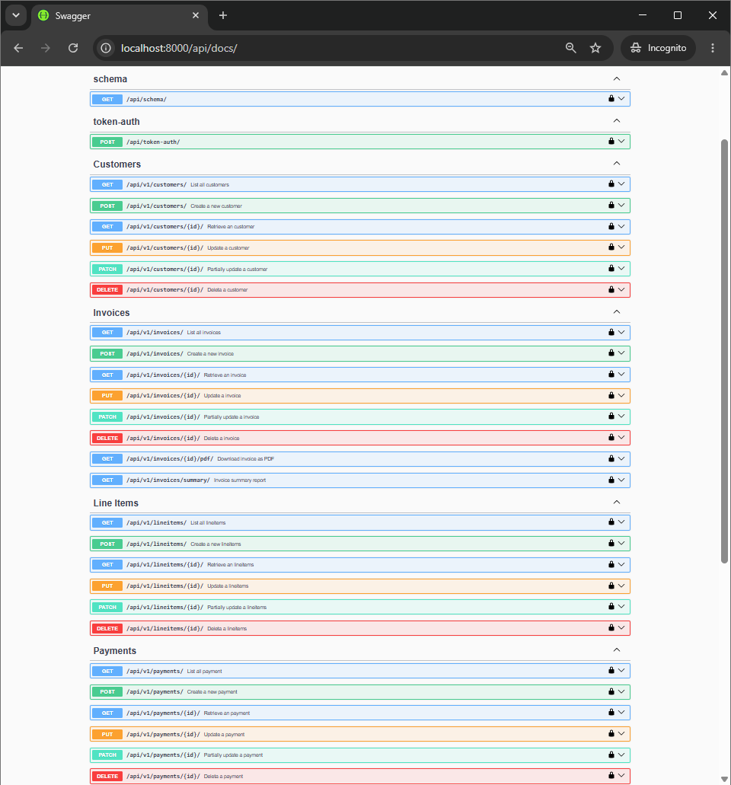
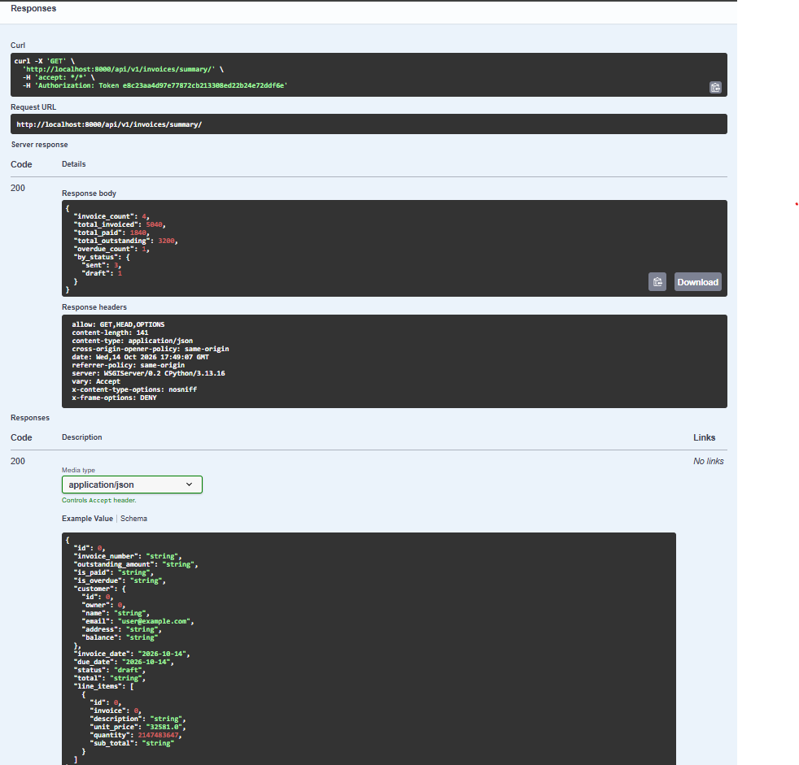
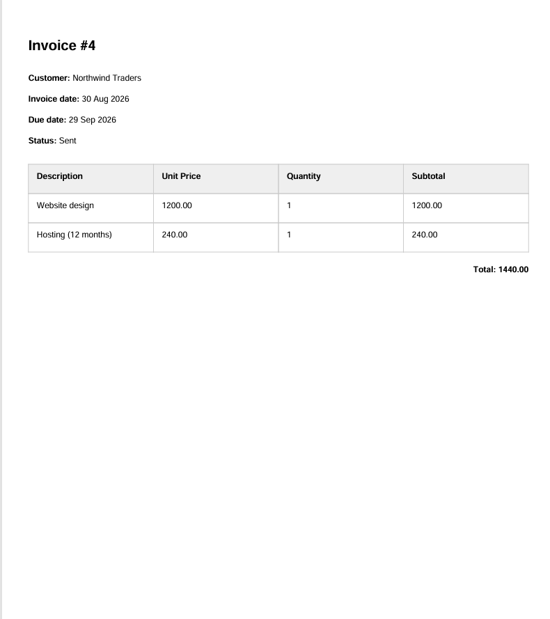

# Invoice & Payments Management API
A REST API for managing invoices, customers, and payments. Built with Django, Django REST Framework, and PostgreSQL, drawing on real invoicing workflows from my background in financial administration.

## Why/Motivation
During my time at my previous employer, through the daily exposure to SalesForce and SAP, processes like creating credit notes, partial payments, due dates, monthly closings, and many other aspects, have taught me how an invoice can have many different statuses, instead of just 'paid' or 'not paid'.

## Live Demo
- API docs (Swagger): https://invoice-api-j4pa.onrender.com/api/docs/
- Demo login: `demo` / `demo12345` (get a token via `POST /api/token-auth/`, then click **Authorize** in Swagger and enter `Token <your-token>`)

> Hosted on Render's free tier: the first request after a period of inactivity can take about a minute while the service wakes up.

## Features
- Manage Customers, Invoices, Line Items, and Payments through a REST API
- Access only granted to authorized users with a token
- Nested writes: create an invoice with its line items in one request
- Automatic invoice numbering
- Totals per customer
- PDF invoice generation
- Token and Session Authentication
- Token-based login endpoint for obtaining an auth token
- Object-level permissions: users only see their own data, and superusers see everything
- Interactive API documentation with Swagger (drf-spectacular)
- Automated tests with pytest, flake8, and black (CI pipeline)
- Runs with a single command using Docker Compose
- Summary report with optional date range filter (`?date_from=YYYY-MM-DD&date_to=YYYY-MM-DD`)

## Tech Stack
- Python
- PostgreSQL
- Django
- Django REST Framework
- drf-spectacular (OpenAPI/Swagger)
- pytest and pytest-django
- xhtml2pdf (PDF generation)
- Docker and Docker Compose
- GitHub Actions (CI)

## Screenshots







[View the sample invoice as a PDF](swagger-images/invoice-4.pdf)

## Run with Docker
1. Install [Docker Desktop](https://www.docker.com/products/docker-desktop/).
2. Clone the repository and open the project folder.
3. Copy the example environment file, Then open `.env` and replace `change-me` with a password of your choice.
```bash
copy .env.example .env # Windows
cp .env.example .env # macOS / Linux
```
4. Start the API and the database:
```bash
docker compose up --build
```
5. In a second terminal, create a superuser (needed for the Django admin):
```bash
docker compose exec web python manage.py createsuperuser
```
6. (Optional) Load demo data:
```bash
docker compose exec web python manage.py seed_demo
```
This creates a user `demo` (password `demo12345`) with sample customers, invoices and payments. For local demo use only.
7. Open the API documentation at `http://localhost:8000/api/docs/`. To log in, get a token with `POST /api/token-auth/`, click **Authorize** and enter `Token <your token>`.

The database starts empty. Its data is stored in a Docker volume on your own machine.
`docker compose down` keeps the data; `docker compose down -v` deletes it.

## Run locally (without Docker)

Requires Python 3.12+ and open the folder:

1. Clone the repository and open the folder:
```powershell
git clone https://github.com/RyuHudson/Invoice-Payments-Management-API.git
cd Invoice-Payments-Management-API
```
2. Create and activate a virtual environment:
```powershell
python -m venv venv
venv/Scripts.activate
```
3. Install the dependencies:
```powershell
pip install -r requirements.txt
```
4. Create a PostgreSQL database named `invoicedb`, then copy `.env.example` to `.env` and fill in your database password.
5. Apply the migrations and create an admin user:
```powershell
python manage.py seed_demo
```
7. Start the server. The API docs are at http://127.0.0.1.:8000/api/docs/
```powershell
python manage.py runserver
```

## API Endpoints

All endpoints are prefixed with `/api/v1/` and require authentication (see [Authentication](#authentication)).
Each user only sees their own data; superusers see everything.

| Resource    |           Endpoint           |       Methods           |
|-------------|------------------------------|-------------------------|
| Customers   | `/api/v1/customers/`         | GET, POST               |
| Customers   | `/api/v1/customers/{id}/`    | GET, PUT, PATCH, DELETE |
| Invoices    | `/api/v1/invoices/`          | GET, POST               |
| Invoices    | `/api/v1/invoices/{id}/`     | GET, PUT, PATCH, DELETE |
| Line Items  | `/api/v1/lineitems/`         | GET, POST               |
| Payments    | `/api/v1/payments/`          | GET, POST               |

`/api/v1/lineitems/{id}/` and `/api/v1/payments/{id}/` support GET, PUT, PATCH and DELETE.

Extra endpoints:

| Method | Endpoint                        | Description                                                     |
|--------|---------------------------------|-----------------------------------------------------------------|
| GET    | `/api/v1/invoices/{id}/pdf/`    | Download an invoice as a PDF                                    |
| GET    | `/api/v1/invoices/summary/`     | Totals and counts; optional `date_from` / `date_to` (YYYY-MM-DD)|
| POST   | `/api/token-auth/`              | Obtain an authentication token                                  |

Requesting an object that belongs to another user returns `404`.

## Authentication
Every endpoint requires authentication, using either a token or a session (logged in via the admin).

To get a token, send your username and password to `/api/token-auth/`:
```json
{"username": "your_username", "password": "your_password"}
```
Response:
```json
{"token": "abc123..."}
```

**In Swagger:** click **Authorize**, enter `Token abc123...` and confirm.

**In other tools** (Postman, curl): add this header to every request:
```
Authorization: Token abc123...
```

## Running Tests
```bash
pytest
```